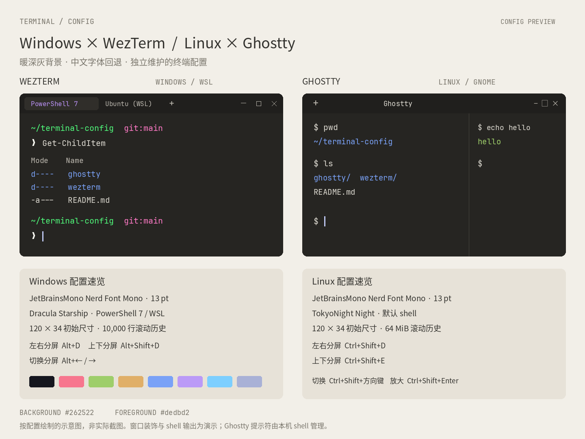

# Terminal config

个人终端配置：**Windows 使用 WezTerm，Linux 使用 Ghostty**。

## 配置预览



> 根据仓库配置绘制的示意图，非实际截图。配色、字体、窗口尺寸与快捷键对应当前配置；窗口装饰和命令输出为演示。WezTerm 展示随仓库提供的 Dracula Starship，Ghostty 的提示符由本机 shell 配置决定。

两套主配置均使用暖深灰背景 `#262522`、柔白文字 `#dedbd2`，主字体为 13 号 `JetBrainsMono Nerd Font Mono`。Windows 中文回退为 Microsoft YaHei，Linux 中文回退为 Noto Sans Mono CJK SC。

| 操作 | WezTerm（Windows） | Ghostty（Linux） |
| --- | --- | --- |
| 左右分屏 | `Alt+D` | `Ctrl+Shift+D` |
| 上下分屏 | `Alt+Shift+D` | `Ctrl+Shift+E` |
| 切换分屏 | `Alt+←` / `Alt+→` | `Ctrl+Shift+方向键` |
| 放大 / 还原当前分屏 | 未自定义 | `Ctrl+Shift+Enter` |

[查看 SVG 原图](assets/terminal-config-preview.svg) · [WezTerm 详细说明](wezterm/README.md) · [Ghostty 详细说明](ghostty/README.md)

## 配置目录

| 目录 | 主要平台 | 内容 |
| --- | --- | --- |
| [wezterm/](wezterm/README.md) | Windows / WSL | WezTerm 配置、Dracula Starship 提示符、PowerShell 与 WSL zsh 初始化片段 |
| [ghostty/](ghostty/README.md) | Linux（Ubuntu / GNOME） | 本机正在使用的 Ghostty 配置与安装说明 |

```text
.
├── README.md
├── assets/                           # 配置可视化（PNG / SVG）
├── wezterm/
│   ├── README.md
│   ├── wezterm.lua                   # 自动选择 WezTerm 平台配置
│   ├── wezterm-windows.lua           # Windows 主配置
│   ├── wezterm-linux.lua             # 旧 Linux 配置，作为备用保留
│   ├── starship.toml                 # Windows / WSL 提示符主题
│   ├── powershell-profile-snippet.ps1
│   └── zshrc-snippet.zsh
└── ghostty/
    ├── README.md
    └── config.ghostty                # Linux 主配置
```

## 使用

- **Windows / WSL**：按 [WezTerm 安装说明](wezterm/README.md) 操作。该说明中的命令在仓库的 `wezterm/` 子目录执行。
- **Linux**：按 [Ghostty 安装说明](ghostty/README.md) 操作。该说明中的命令在仓库根目录执行。

两个终端的配置分别维护，保留各自现有的配色与快捷键。
Ghostty 配置来自本机 `${XDG_CONFIG_HOME:-$HOME/.config}/ghostty/config.ghostty`，未收录历史备份和桌面启动器。

## 从旧仓库布局迁移

原根目录下的 WezTerm 配置、Starship 主题和 shell 片段全部移入 `wezterm/`，内容保持不变。
如果此前直接引用了仓库内的文件（例如符号链接或脚本），请在原路径中加入 `wezterm/`。
此前复制到用户配置目录的文件可以继续使用。

仓库已更名为 [`terminal-config`](https://github.com/22364yiqun/terminal-config)。已有克隆可更新远端地址：

```bash
git remote set-url origin https://github.com/22364yiqun/terminal-config.git
```

新设备可直接克隆：

```bash
git clone https://github.com/22364yiqun/terminal-config.git
cd terminal-config
```
